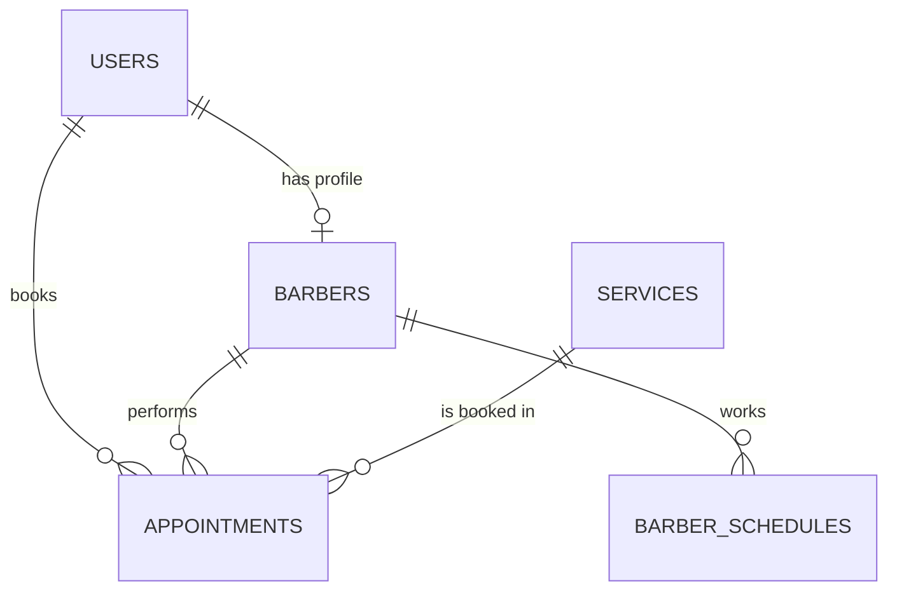

# Data model

## Entity relationships

## Relationships

| Relationship | Cardinality | Foreign key |
|---|---|---|
| users - barbers | 1 to 0..1 | barbers.user_id (unique) |
| users - appointments | 1 to N | appointments.user_id |
| barbers - barber_schedules | 1 to N | barber_schedules.barber_id |
| barbers - appointments | 1 to N | appointments.barber_id |
| services - appointments | 1 to N | appointments.service_id |

`appointments` is the join between users, barbers and services. Clients and barbers are related many-to-many through it.

## Tables

| Table | Columns |
|---|---|
| users | id, email (unique), password_hash, full_name, phone, role (client / barber / admin), created_at |
| barbers | id, user_id (unique, FK), display_name, active |
| services | id, name, duration_minutes (> 0), price (>= 0), active |
| barber_schedules | id, barber_id (FK), weekday (0-6), start_time, end_time (> start_time) |
| appointments | id, user_id (FK), barber_id (FK), service_id (FK), starts_at, ends_at (> starts_at), status (confirmed / cancelled), created_at |

## Design decisions

- **Stored end time:** `ends_at` is stored, not computed. Changing a service duration later does not move existing appointments, and the database can enforce no-overlap per barber.
- **Timestamps:** `timestamptz`, stored in UTC.
- **Barber as a profile:** `barbers` references `users`, so the database guarantees that `barber_id` points to a real barber.
- **All barbers do all services** in v1. A `barber_services` join table can be added later.
- **No hard deletes** for services and barbers: they are deactivated.
- **No personal data beyond what is needed** (no national ID).
- **No-overlap rule:** enforced in the database. Covered in a later ticket.
